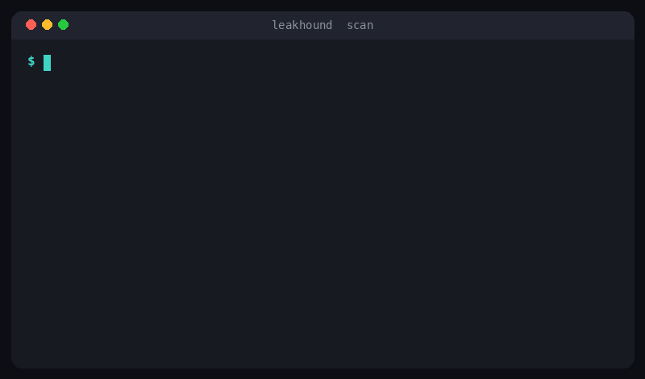

<div align="center">

# 🐾 LeakHound

### Catch leaked secrets before they ship.

LeakHound scans your code, config, and git history for hardcoded credentials such as API keys, cloud secrets, and private keys, then reports exactly where each one lives. It is a single, zero dependency Python tool that runs on your laptop, in your commit hooks, and in CI.


<br>



</div>

## Why LeakHound

A single leaked token can hand an attacker your cloud account, your email, or your production database. Secrets slip into commits all the time: a quick test, a copied snippet, a config file that was supposed to stay local. LeakHound is the check that catches them early, before they reach a shared branch or a public repository.

It is built to be boring in the best way. There is nothing to host, no account to create, and no dependency tree to audit. You point it at a path, it reads your files, and it tells you what looks dangerous.

## What it finds

1. Private keys in PEM form (RSA, EC, DSA, OpenSSH, PGP).
2. Cloud credentials, including AWS access key ids and secret access keys.
3. GitHub tokens: classic, fine grained, OAuth, app, and refresh.
4. Provider keys for Google, Slack, Stripe, SendGrid, OpenAI, and npm.
5. Slack incoming webhooks and JSON web tokens.
6. Usernames and passwords embedded in connection urls.
7. Secret looking values assigned to sensitive variables.
8. Long, random looking strings, caught by a Shannon entropy check.

Run `leakhound rules` to see the full list with severities.

## Install

With pipx, straight from the repository:

```bash
pipx install git+https://github.com/SiteQ8/LeakHound.git
```

Or with pip from a clone:

```bash
git clone https://github.com/SiteQ8/LeakHound.git
cd LeakHound
pip install .
```

You can also run it without installing anything, since it uses only the standard library:

```bash
git clone https://github.com/SiteQ8/LeakHound.git
cd LeakHound
python -m leakhound scan /path/to/your/project
```

## Quick start

```bash
# scan the current directory
leakhound scan .

# scan a single file
leakhound scan config/production.env

# see the built in rules
leakhound rules
```

LeakHound exits with a nonzero code when it finds anything, so it fits naturally into scripts and pipelines. Add `--exit-zero` if you want it to report without failing the build.

## Usage

Machine readable output for tooling:

```bash
leakhound scan . --format json
```

SARIF output, ready to upload to GitHub code scanning so findings appear in the Security tab and on pull requests:

```bash
leakhound scan . --format sarif > leakhound.sarif
```

Scan the whole git history, not just the working tree. This catches secrets that were committed once and later deleted, which stay recoverable in the history:

```bash
leakhound scan . --git-history
```

Turn off the entropy detector and use only the named rules, which is stricter and quieter:

```bash
leakhound scan . --no-entropy
```

Skip paths with a glob, as many times as you like:

```bash
leakhound scan . --exclude "tests/*" --exclude "*.min.js"
```

## Run it before every commit

LeakHound ships a hook definition, so you can wire it into your commit checks. Add this to a `.pre-commit-config.yaml` in your repository:

```yaml
repos:
  - repo: https://github.com/SiteQ8/LeakHound
    rev: v0.1.0
    hooks:
      - id: leakhound
```

Now every commit is scanned, and a leaked secret stops the commit before it happens.

## Run it in CI

Fail the build when a secret shows up, and publish findings to the Security tab:

```yaml
name: secret scan
on: [push, pull_request]
jobs:
  leakhound:
    runs-on: ubuntu-latest
    steps:
      - uses: actions/checkout@v4
      - uses: actions/setup-python@v5
        with:
          python-version: "3.12"
      - run: pip install git+https://github.com/SiteQ8/LeakHound.git
      - run: leakhound scan . --format sarif > leakhound.sarif
      - uses: github/codeql-action/upload-sarif@v3
        with:
          sarif_file: leakhound.sarif
```

## Reducing noise

Real projects have some strings that look like secrets but are safe. LeakHound gives you three ways to quiet them.

1. Add a marker comment on the line to allow it: end the line with `leakhound:allow`.
2. Create a `.leakhoundignore` file with glob patterns, one per line, for paths to skip.
3. Raise the entropy threshold with `--entropy-threshold`, or turn the detector off with `--no-entropy`.

Findings are shown with a stable fingerprint, which makes it easy to track or allow a specific one over time.

## How it works

LeakHound reads each text file line by line and applies two kinds of checks. The first is a set of curated patterns for well known secret formats, which are precise and high confidence. The second is an entropy check that flags long strings that look random, which catches secrets that do not match any known shape. Binary files, common build folders, and anything you exclude are skipped. Secrets are always masked in the output, so the report itself never leaks them.

## Exit codes

* `0` means nothing was found, or you passed `--exit-zero`.
* `1` means at least one finding.

## Project layout

```
leakhound/
├── leakhound/
│   ├── cli.py         # command line interface
│   ├── scanner.py     # the scanning engine, including git history
│   ├── rules.py       # detection rules
│   ├── entropy.py     # Shannon entropy
│   ├── findings.py    # the Finding type, masking, fingerprints
│   └── report.py      # text, json, and SARIF output
├── tests/             # unit tests
├── examples/          # a sample file with fake secrets
└── docs/              # the demo
```

## Roadmap

See [ROADMAP.md](ROADMAP.md) for what is planned, including a configuration file, more providers, and a baseline mode that only reports new findings.

## Contributing

Issues and pull requests are welcome. New rules, fewer false positives, and more tests are all valuable. See [CONTRIBUTING.md](CONTRIBUTING.md) to get started.

## License

MIT. See [LICENSE](LICENSE). Free to use, change, and share.

<div align="center">

Built by [SiteQ8](https://github.com/SiteQ8). We build open source tools, agents, and technology.

If LeakHound keeps a secret out of your history, a star is welcome.

</div>
